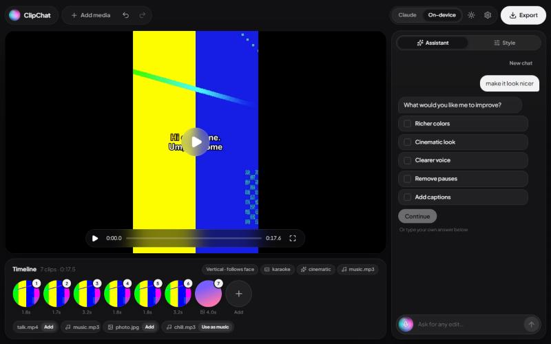

# ClipChat

A desktop video editor for everyone, wrapped in liquid glass with a Siri-style assistant orb. Drop in your clips, then just say what you want:
*"remove the pauses and the ums, make it vertical for TikTok, add karaoke captions and my song
quietly underneath"*. Or don't type at all: tap a preset like **TikTok / Reels** or use the
**Style** panel's buttons, sliders and swatches.

Runs on **Claude** (cloud, smartest) or **any tool-calling model on your own computer via
Ollama** (free and private). Speech recognition, face tracking and rendering always run locally.



## What it can do

| | |
|---|---|
| **Cut** | trim, cut any section, split, delete, reorder (drag or ask), "keep only the best 30 seconds" |
| **Clean up speech** | remove pauses (from the audio), remove filler words like *um*, *uh* and *you know* (from the transcript), cut by content ("remove the part about pricing") |
| **Shape** | vertical 9:16, square, widescreen; fill by **following the speaker's face**, blurred background, crop or bars |
| **Captions** | auto-generated from speech in four styles, including **karaoke** (each word lights up as it's spoken); export a `.srt` subtitle file too |
| **Look** | color looks (warm, cool, vivid, cinematic, vintage, black & white) plus brightness, contrast and saturation |
| **Sound** | **studio voice** (denoise, speech EQ, gentle compression), loudness levelling to social-media level, background music that **automatically dips when someone talks** |
| **Motion** | speed up or slow down any clip, punch-in zoom, fades between clips, fade in/out |
| **Photos** | import images for slideshows; each photo gets a slow push-in |
| **Presets** | TikTok / Reels, YouTube, Podcast clip, Cinematic, Photo slideshow, Quick clean-up. One tap, no AI needed, one undo step |
| **Accessibility** | speak instead of typing (local Whisper dictation), light/dark/auto theme, large text, keyboard control, reduced-motion support |

## Install (Windows)

Run **`ClipChat-Setup-1.0.0.exe`**. It installs ClipChat for your user account (no admin needed),
adds Start menu and desktop shortcuts, and registers an uninstaller under *Apps > Installed apps*.
Everything it needs is inside: the editing engine, FFmpeg and the speech model. You don't need
Python, Node or FFmpeg, and everything except Claude works offline.

The installer isn't code-signed yet, so Windows SmartScreen may say *"Windows protected your PC"*.
Click **More info → Run anyway**.

## How it works

```
 Electron UI (React)  ──HTTP + per-launch token──▶  Python engine (FastAPI, 127.0.0.1 only)
   chat · style panel · preview · clip strip         │
                                                     ├─ Agent loop ─▶ Claude API  or  Ollama
                                                     │      │  tool calls
                                                     │      ▼
                                                     ├─ Editor: 23 editing tools + presets over a JSON timeline
                                                     │      (undo/redo = timeline snapshots)
                                                     ├─ Whisper (faster-whisper): word timestamps, dictation
                                                     ├─ OpenCV: face tracking for smart reframing
                                                     └─ FFmpeg: one filter graph renders the timeline
```

1. **The AI never touches pixels.** The project is a small JSON *timeline*: an ordered list of
   source segments (each with its own speed and zoom) plus settings (shape, captions, look, audio,
   music, transitions, text). The model edits it by calling tools such as `cut_section`,
   `remove_silences`, `set_look` or `keep_only`. The UI's buttons call the very same tools, so
   chat and clicks always agree, and every edit is instant and undoable. A failed edit rolls back.
2. **Each turn includes the current state.** Every message carries a compact summary of the
   timeline, so the model always knows clip numbers, lengths and settings.
3. **Speech-aware editing.** Whisper produces word-level timestamps in *source* time. Captions,
   filler removal and cutting by content map those words through the timeline (including speed
   changes) into *output* time. Whisper normally cleans up disfluencies, so it's primed with a
   filler-heavy prompt to keep them.
4. **Smart reframing.** OpenCV samples two frames a second, finds the most prominent face (it
   prefers faces close to where the subject just was, and rejects one-frame false hits), then
   median-filters and eases the track. The renderer turns it into an animated FFmpeg crop, so a
   landscape interview becomes a vertical video that follows the speaker.
5. **Rendering.** Each clip is a seeked FFmpeg input with its own chain (smart crop or fit, zoom,
   speed, color look, fades; photos get a gentle push-in). The joined video gets captions and
   titles from an ASS subtitle file. The joined audio gets voice cleanup, then music mixed through
   a sidechain compressor keyed by the voice (that's the automatic ducking), then EBU R128
   loudness levelling to −14 LUFS. A low-res preview re-renders after every edit. Long timelines
   render in chunks to stay under Windows' command-line limit.

### Two model backends, one tool set

| | Claude | On-device (Ollama) |
|---|---|---|
| Model | `claude-opus-5-5` (configurable) | any tool-calling model, e.g. `llama3.1:8b`, `mistral-nemo` |
| Tool calls | `strict: true` schemas, so arguments always validate | arguments are coerced (`"0:15"` → 15, `"2x"` → 2) |
| Quirk handling | server-side refusal fallback enabled | recovers tool calls written as JSON text, strips echoed state, trims history to fit a small context |

Small local models handle direct requests ("make it square", "remove the pauses", "make it look
cinematic"). For multi-step requests or choosing highlights by meaning, Claude is noticeably better.

## Requirements

- **FFmpeg** on your PATH (`ffmpeg -version` should work). On Windows: `winget install Gyan.FFmpeg`.
- **Python 3.10+** and **Node.js 18+**
- For Claude: an Anthropic API key. For on-device: [Ollama](https://ollama.com) with a tool-capable
  model (`ollama pull llama3.1:8b`).

## Setup

```bash
cd clipchat/backend
python -m venv .venv
.venv/Scripts/python -m pip install -r requirements.txt    # macOS/Linux: .venv/bin/python
cd ..
npm install
```

The first time you use captions, filler removal or dictation, Whisper downloads its `base` model
(~140 MB). It runs on your NVIDIA GPU if CUDA is set up, otherwise on the CPU.

## Run

```bash
npm start
```

Then open **Settings** (⚙) and paste your Anthropic API key, or pick **On-device** in the top bar
to use Ollama. The key can also come from the `ANTHROPIC_API_KEY` environment variable. If you
save it in Settings, it's stored in plain text in ClipChat's app-data folder
(`%APPDATA%\clipchat\settings.json` on Windows).

For UI development with hot reload: `npm run dev`.

## Building the installer

```bash
npm run dist
```

This builds the UI, then `scripts/build_engine.py` bundles the Python engine into a standalone
`clipchat-engine.exe` with PyInstaller (install `backend/requirements-build.txt` into the backend venv first) and
copies in `ffmpeg.exe` and the Whisper `base` model. Finally electron-builder wraps it all into
`release/ClipChat-Setup-<version>.exe` (about 390 MB). The app icon is drawn by
`scripts/make_icon.py`. After the first full build, `npm run dist:app` repackages UI changes
without rebuilding the engine.

The installed app ships only `ffmpeg.exe`; it reads media with PyAV, so it doesn't need
`ffprobe`. The bundled FFmpeg build is GPL-licensed, so if you distribute the installer publicly,
include FFmpeg's license and a link to its source.

## Things to try

- "Remove the awkward pauses and the ums"
- "Make it a TikTok with karaoke captions that follows my face"
- "Clean up the background noise"
- "Make it look cinematic and a bit brighter"
- "Play clip 2 in slow motion and zoom in on clip 3"
- "Keep only the best 30 seconds"
- "Find where I say 'pancakes' and cut everything before it"
- "Add song.mp3 quietly in the background"
- "Put the title 'Pancake Time' at the top for the first 3 seconds"

Ctrl+Z / Ctrl+Shift+Z undo and redo any edit, whoever made it. In the clip strip, Delete removes
the focused clip and Alt+←/→ moves it.

## Tests

```bash
npm test
```

58 tests cover timeline range math (including speed), every editing tool and preset, face-track
smoothing and the crop expressions it generates, real FFmpeg renders of generated clips (every
effect at once, photo slideshows, silence removal, chunked rendering, thumbnails), karaoke and SRT
captions, both agent loops against scripted fake models, and the HTTP API, including the auth token.

## Project layout

```
electron/        main process (starts the engine, window chrome, mic permission) + preload bridge
src/             React UI: App, Preview (player), Timeline, Chat (+ dictation), StylePanel,
                 ExportDialog, Settings
backend/clipchat/
  timeline.py    the data model, range math, undo history
  tools.py       tool schemas, presets, and the Editor that executes them
  llm.py         Claude and Ollama agent loops
  transcribe.py  Whisper transcription, dictation, filler detection, phrase search
  reframe.py     face tracking and smoothing for smart reframing
  media.py       ffprobe, silence detection, thumbnails
  render.py      FFmpeg filter-graph builder, looks, audio chain, ASS/SRT captions
  server.py      FastAPI app, preview worker, export jobs
```
